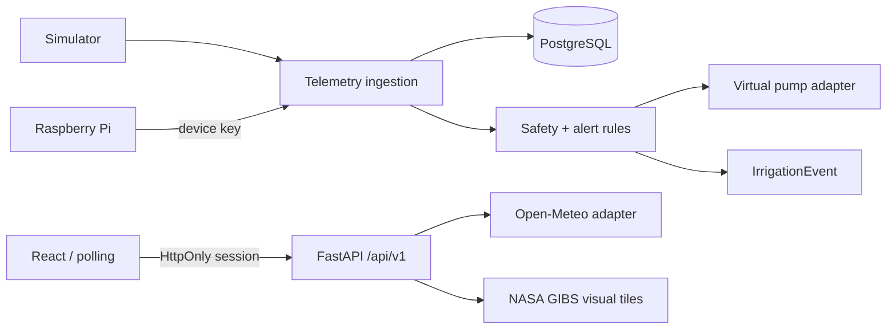

# Архитектура GAIA MVP

GAIA — модульный монолит: React/Vite отвечает за русский интерфейс, FastAPI — за авторизацию, владение данными и прикладные операции, SQLAlchemy/Alembic — за PostgreSQL. SQLite поддерживается как облегчённый тестовый режим.

Симулятор и устройство используют `Telemetry` и функцию `ingest`. Источник хранится с записью. Невалидное или устаревшее показание блокирует запуск. Решение проверяет режим, свежесть, пороги, резервуар, cooldown, дневной лимит, аварийную блокировку и прогноз; причина сохраняется в `IrrigationEvent`.

Авторизация — непрозрачная случайная сессия в HttpOnly cookie; в БД хранится SHA-256 хэш токена, пароль — Argon2. Изменяющие browser-запросы требуют ожидаемый Origin и заголовок `X-GAIA-Request`. Все вложенные endpoints сначала проверяют владельца и возвращают 404 для чужого ресурса. Фото декодируется Pillow, преобразуется в JPEG, получает случайное имя и выдаётся только через авторизованный endpoint владельца.

Open-Meteo вызывается server-side с timeout 8 секунд. Успешный ответ кэшируется 20 минут, ошибка — 2 минуты; при сбое возвращается последняя запись как `stale`, без подмены симуляцией. NASA GIBS — обзорный MODIS-слой 250 м/пиксель, без ложного NDVI для отдельных растений.

Фоновый цикл MVP должен работать ровно в одном API worker. Compose и скрипты запускают `--workers 1`; горизонтальное масштабирование потребует отдельного scheduler или PostgreSQL advisory lock.
