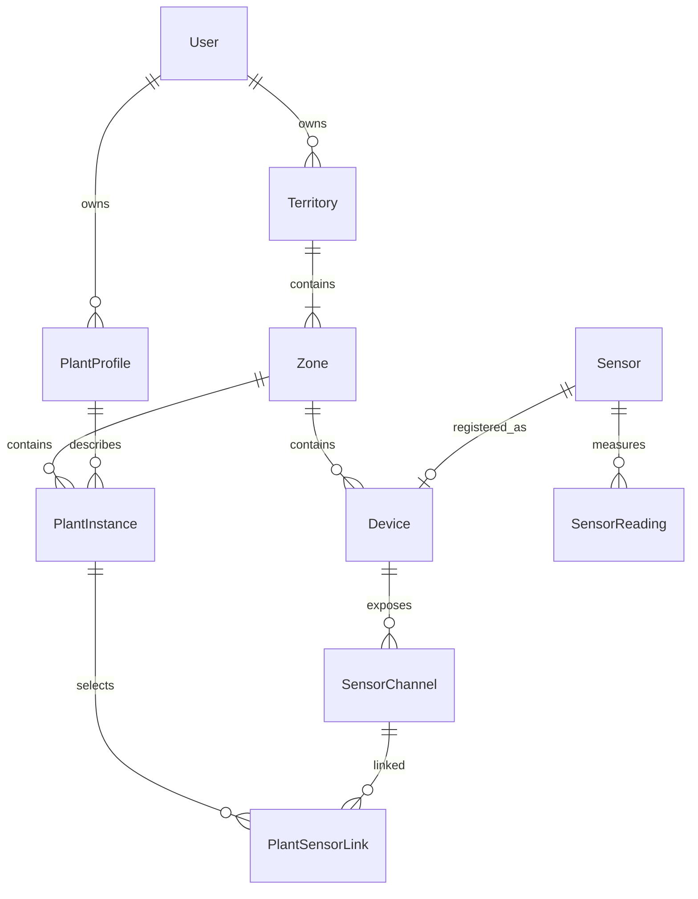

# GAIA: архитектура и порядок расширения

Phase 1 расширяет существующий MVP. Единственный симулятор, авторизация, территории, история показаний, виртуальный полив, наблюдения, погода и отчёты сохраняются.

## Результат аудита

До Phase 1 `Sensor` представлял одну многоканальную станцию, а ограничение `(territory_id, source)` мешало подключать несколько реальных станций. `IrrigationZone` — состояние одного виртуального насоса, а не географическая зона. Запрос последнего показания смешивал реальные UTC timestamps с ускоренными часами симулятора. Реальный ingest мог вызвать оценку виртуального полива. Большинство API-маршрутов находились в `main.py`.

Переиспользуются FastAPI, SQLAlchemy, Alembic, Pydantic, Argon2 и cookie sessions, единый `SensorReading`, генератор `domain.tick`, существующие ограничения полива, React Router/Query, формы, Leaflet и Recharts. Новых зависимостей Phase 1 не требует.

## Модель данных

- `Zone`: территория, имя, описание, основная зона, даты создания/изменения.
- `PlantProfile`: владелец, обычное/научное название, описание, nullable числовые диапазоны почвенной влажности, температуры, влажности воздуха и pH; свет, полив, питание, список заболеваний. Требования стадий — ограниченная Pydantic-структура JSON, произвольные ключи запрещены.
- `PlantInstance`: профиль, территория, зона, имя, дата посадки, стадия, камера, выбранные сенсорные каналы. `health_status=UNKNOWN` до реализации анализа. Стадии: seedling, vegetative, flowering, fruiting, mature.
- `Device`: зона, территория, тип SENSOR/ACTUATOR/CAMERA/CONTROLLER, источник REAL/SIMULATED, активность, серверное last_seen, даты. Прежние Sensor и IrrigationZone связаны через `legacy_sensor_id`/`legacy_irrigation_id`, их ID не меняются.
- `SensorChannel`: тип, единица, сведения о калибровке. Последнее значение и его время берутся из общей истории. `quality` описывает исходное измерение, `availability` — его текущую доступность/свежесть.
- `PlantSensorLink`: уникальная пара растения и канала. Связи разрешены только внутри одной зоны.

Ключи устройств хранятся в прежнем Sensor только в виде хеша. Выдача/ротация относится к конкретному REAL SENSOR. Деактивация отзывает ключ, сохраняя историю. Перенос устройства с показаниями или привязками блокируется, чтобы не переписать смысл исторической принадлежности зоне.

## Разделение источников

Канонические значения реестра — `REAL` и `SIMULATED`. Старый v1 payload сохраняет `source=device` и `source=simulated`; преобразование выполняется при привязке станции к Device. SensorReading остаётся единственным хранилищем телеметрии.

Старые обзор, предупреждения, графики, отчёты и полив работают в контексте SIMULATED. REAL данные доступны в карточках устройств и растений. История территории по умолчанию ограничена `source=simulated`; явные фильтры `source=device` и `sensor_id` позволяют читать реальные измерения. Нет общего усреднения REAL и SIMULATED.

REAL ingest обновляет историю и last_seen, не меняет часы/почву/воду симулятора, виртуальный насос, его события и предупреждения. Веб-клиент не может создать второй симулятор через регистрацию устройства. Виртуальные станция и насос принадлежат основной зоне; дополнительные зоны не получают вымышленную независимую симуляцию.

Статус REAL SENSOR: OFFLINE до первого пакета, при деактивации или более 120 секунд без приёма; ONLINE после валидного пакета; WARNING/ERROR при stale/invalid качестве последнего пакета. SIMULATED — происхождение виртуального устройства, а не утверждение о физическом соединении. У реальной камеры/привода до их подключения статус OFFLINE и неизвестное состояние. Калибровка пока является метаданными для клиента и не пересчитывает историю на сервере.

## План по файлам и реализация Phase 1

| Файл | Изменение |
|---|---|
| `apps/api/gaia/foundation_models.py` | Зоны, профили, экземпляры растений, устройства, каналы, связи |
| `apps/api/gaia/foundation_schemas.py` | Строгие входные и выходные структуры, диапазоны, стадии, статусы |
| `apps/api/gaia/services/foundation.py` | Инициализация основной зоны, устройства, ключи, связи, источник и свежесть показаний |
| `apps/api/gaia/api/dependencies.py` | Общая DB dependency и проверка владельца территории |
| `apps/api/gaia/api/routes/foundation.py` | CRUD новых сущностей и чтение привязанных сенсоров |
| `apps/api/gaia/api/routes/legacy.py` | Существующие маршруты с сохранёнными URL, ограничение источника и адаптер прежнего ключа |
| `apps/api/gaia/main.py` | Жизненный цикл, middleware и подключение routers |
| `apps/api/gaia/domain.py` | Единственный симулятор; защита от смешения REAL/SIMULATED; межпоточная блокировка |
| `database/versions/7b94d6120344_phase1_foundation.py` | Добавочные таблицы и backfill без изменения исторических ID |
| `database/env.py` | Транзакционная перестройка SQLite с проверкой FK до commit |
| `apps/web/src/foundation/` | Отдельные формы профилей, зон, устройств, растений; показания и источники |
| `apps/web/src/main.tsx`, `pages.tsx`, `Territory.tsx` | Маршруты, навигация, подписи источников и сброс состояния при смене территории |
| `tests/test_foundation.py` | Авторизация, связи, источники, ключи и сохранение истории |
| `tests/test_migrations.py` | Fresh upgrade, populated upgrade, rollback при искусственном сбое |
| `apps/web/e2e/foundation.spec.ts` | Реальный браузерный путь профиль → зона → устройство → растение |

## Новые API

Все URL имеют префикс `/api/v1`. Browser CRUD требует пользовательскую сессию и `X-GAIA-Request: 1` для изменений.

| URL | Методы / назначение |
|---|---|
| `/territories/{tid}/zones` | GET список, POST создание |
| `/zones/{id}` | GET, PUT, DELETE; основную/используемую зону удалить нельзя |
| `/plant-profiles` | GET собственные профили, POST |
| `/plant-profiles/{id}` | GET, PUT, DELETE; используемый профиль защищён |
| `/territories/{tid}/devices` | GET с фильтром source, POST регистрация REAL |
| `/devices/{id}` | GET; PUT имя/зона/активность |
| `/devices/{id}/credential` | POST выдача/ротация ключа REAL SENSOR, показывается один раз |
| `/devices/{id}/readings` | GET история конкретной станции, limit 1–1000 |
| `/sensor-channels/{id}/calibration` | PUT метаданные калибровки |
| `/territories/{tid}/plants` | GET с фильтром zone_id, POST |
| `/plants/{id}` | GET, PUT, DELETE; PUT включает список sensor_channel_ids и camera_device_id |
| `/plants/{id}/readings` | GET текущие/исторические значения только привязанных каналов, source REAL/SIMULATED, limit на канал 1–1000 |

Прежний `/devices/telemetry` принимает Bearer token конкретной станции, проверяет источник, допустимость измерений, время в пределах ±5 минут и строгий рост timestamp. Устройство не получает доступа к пользовательскому CRUD. Старый `/territories/{tid}/sensors/device-credential` остаётся адаптером для единственной REAL станции; при нескольких станциях требует выбрать конкретное устройство.

## Безопасный порядок следующих фаз

1. **Phase 1 — фундамент:** модели/миграции → API → UI → тесты сохранности, imports, startup и build.
2. **Phase 2 — IoT:** `devices/raspberry_pi/` с чтением реальных сенсоров; отдельные `api/routes/device_ingest.py` и `services/device_auth.py`; heartbeat и состояние связи. Проверять обрыв связи, replay и ротацию ключа. Существующий `client.py` отправляет образец payload и не читает GPIO.
3. **Phase 3 — анализ:** `services/features.py`, `anomaly_detection.py`, `plant_health.py`, `decision_engine.py`; версии моделей, обучающая выборка, provenance, объяснимые факторы. IsolationForest — детектор аномалий, не диагноз заболевания. Health Score не показывается без достаточных данных. NumPy/scikit-learn добавлять вместе с этим этапом.
4. **Phase 4 — выполнение:** отдельные `Command`, `CommandAck`, `CommandResult`; `services/safety.py`, `command_service.py`, адаптеры virtual/raspberry_pi. Ограничения времени, воды, частоты, свежести и emergency проверяются независимо от DecisionEngine. Pending/ACK/result не подменяются успешным состоянием насоса. Начать с симулятора и dry-run; физический привод подключать после испытаний.
5. **Phase 5 — Vision:** фото/камера → хранение → очередь inference → версия предобученной модели → результат/неопределённость. Конкретную модель и PyTorch/ONNX runtime выбирать после проверки лицензии, поддерживаемых культур, задач и ресурсов CPU. Нет случайного диагноза или выдуманной confidence.
6. **Phase 6 — погода:** выделить provider-интерфейс над уже существующим Open-Meteo, проверяемый forecast/cache/staleness. Не выдавать недоступный прогноз за благоприятную погоду.
7. **Phase 7 — LLM:** `services/assistant_context.py` и `assistant.py`, структурированный контекст с источниками и временем. Ассистент объясняет данные и решения; токенов/инструментов исполнения приводов у него нет. Секреты только через окружение.

pH/EC/NPK и дозирование требуют расширенного контракта, проверки единиц и калибровки, ограничений совместимости и отдельного виртуального испытательного контура. Добавлять их после основного исполнения команд, не изображать физически подключёнными на Phase 1.

## Ограничения проверки

SQLite миграция должна выполняться при остановленном API. До обновления пользовательской базы нужна проверенная резервная копия. Downgrade Phase 1 намеренно запрещён: он удалил бы растения и столкнулся бы с несколькими REAL станциями; восстановление выполняется из копии. Генерация PostgreSQL DDL проверяет компиляцию, но не заменяет live PostgreSQL integration test. Приложение по-прежнему запускается с одним API worker.
